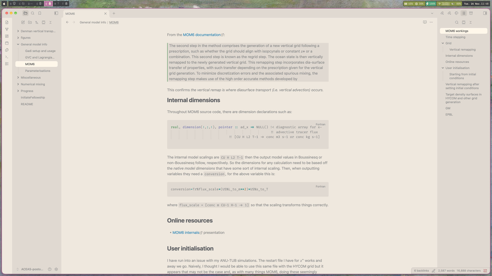
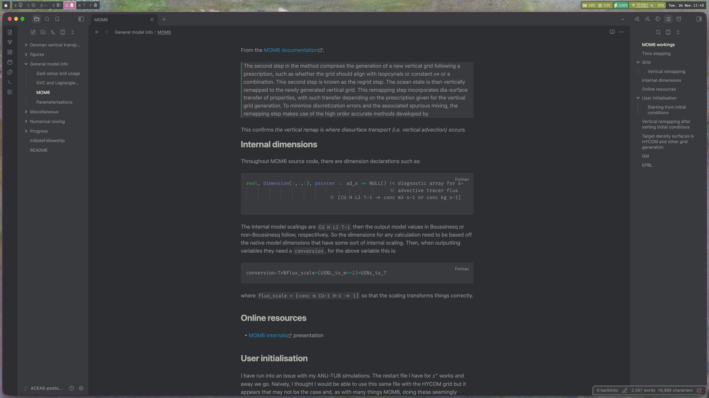
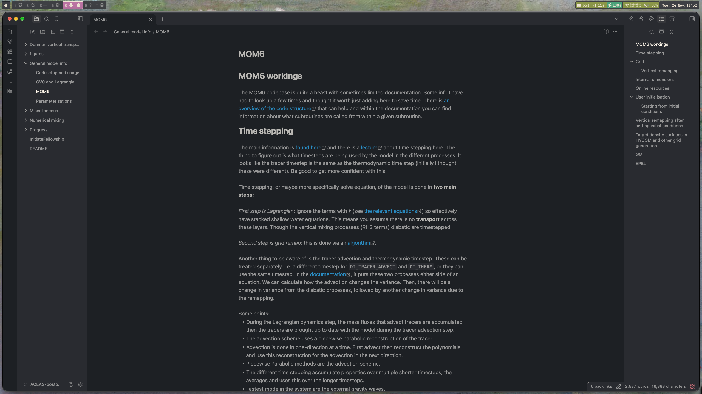
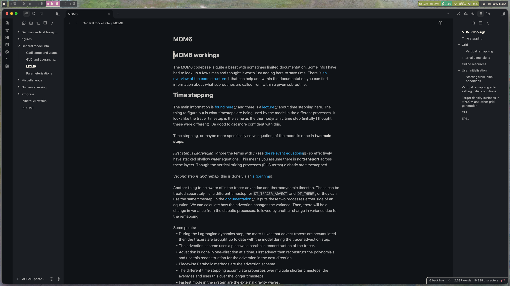

# Penumbra theme for obsidian

Light and dark [penumbra](https://github.com/nealmckee/penumbra) colour themes for [obsidian](https://obsidian.md/).
This theme is a work in progress so issues and PRs are welcome!

## Screenshots

| Balanced light|
|:---:|
||
| **Balanced dark** |
||
| **Dark contrast plus** |
||
| **Dark contrast plus plus** |
||

